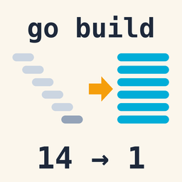
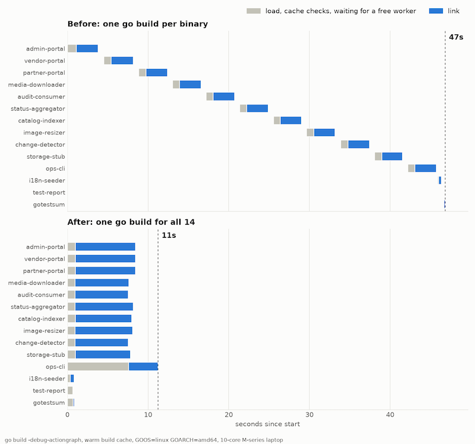

# Go Parallel Builds: 14 Binaries, One go build
<!-- tags: golang, ci, make -->



## TL;DR

- **One `go build` instead of 14:** the build step in our CI went from **78s to 17s** (median of 5 runs each).
- **Whole CI job:** **152s → 76–97s** (one run before the change, 3 runs after).
- **No tuning needed:** the default `-p` was as fast as anything I set by hand.
- **Same lesson in tests:** our `go test` run is build-bound. 39s of a 49s warm run is compile and link, and only \~15s is test execution.

## The Problem

Our Go monorepo ships 14 binaries: three web portals, a handful of queue workers, a CLI and some e2e helpers. The `build-apps` CI job built them in a loop, one `go build` per binary, then ran `--help` on each one as a smoke test.

```make
# before (simplified)
build-apps:
	for app in $(APPS); do \
		go build -ldflags="$(LDFLAGS)" -o build/$$app ./apps/$$app || exit 1; \
	done
```

The build cache was warm, so the shared packages weren't recompiled. The job still took **152s**, and the build steps alone took **81s**. Every iteration loads the package graph again, checks the cache again, and links one big static binary, while the rest of the 8-CPU CircleCI `large` executor sits idle.

## The Fix

`go build` accepts many main packages at once. With `-o` pointing at a directory (trailing slash), it writes one binary per package, named after the last element of its import path.

```make
# No -p: defaults to GOMAXPROCS.
build-binaries:
	env CGO_ENABLED=0 GOOS=linux GOARCH=amd64 \
		go build -ldflags="$(LDFLAGS)" -o build/ \
		$(foreach a,$(BUILT_APPS),./apps/$(a)) $(E2E_TOOL_PKGS)
```

Why not just `go build -o build/ ./apps/...`? It builds the same 11 apps, but the e2e tools live outside `apps/` (`./testing/e2e/report`, `gotest.tools/gotestsum`), and a release builds just the one app it deploys. An explicit list covers both.

In CircleCI, 11 build steps, 10 verify steps and a "Build e2e tools" step (3 more binaries) became one `make build-binaries verify-binaries` step. A separate `verify-binaries` target still runs `--help` on each app. Output paths and ldflags stayed the same, so the Dockerfiles didn't change.

I measured it on the same commit and cache, with 5 CI runs per variant:

| Variant                         | Median  | Range  |
| ------------------------------- | ------- | ------ |
| Serial loop (before)            | 78s     | 71–98s |
| `-p 2`                          | 39s     | 34–42s |
| `-p 4`                          | 21s     | 20–28s |
| `-p 6`                          | 17s     | 13–22s |
| Default (`-p` = GOMAXPROCS = 8) | **17s** | 16–20s |

## Why It Works

- **One package graph.** A single invocation loads and resolves the module graph once. Shared packages are compiled (or fetched from the cache) once and reused by every binary.
- **Parallel actions.** `go build` schedules compile and link actions on a worker pool of size `-p`. In the loop, every link waited for the previous binary. Now up to 8 links run at the same time.
- **Default `-p` is right.** `-p` defaults to GOMAXPROCS, and since Go 1.25 GOMAXPROCS follows the container's CPU quota. On CircleCI `large` that's 8. My runs showed `-p 4` slower and `-p 6` no faster than the default, so the Makefile sets nothing.
- **Linking dominates a warm build.** With a warm cache there is little left to compile, and linking 14 static binaries is the real work. It parallelizes well: `-p 2` halves the time and `-p 4` nearly quarters it.

To see where the time goes, `go build -debug-actiongraph=out.json` (an undocumented debug flag) dumps every action with its start and end time. Here are the same 14 binaries, built both ways on my laptop:



| Wall clock (laptop) | Before (14 builds)  | After (1 build)   |
| ------------------- | ------------------- | ----------------- |
| Load packages       | 7s                  | 0.7s              |
| Cache checks        | 10s (22,119 checks) | 1s (2,108 checks) |
| Link                | 30s, one at a time  | 10s, side by side |
| **Total**           | **47s**             | **11s**           |

Loading and checking the packages once saves about 15s. Running the links side by side saves about 20s. In the chart, the `ops-cli` tail is waiting for a free worker. (The binary names are anonymized.)

The [Appendix](#appendix-check-your-own-repo) shows how to record and read these action graphs for your own repo.

## The Same Lesson in Tests

After the build fix I looked at `go test` with the same eyes. Our unit test run is mostly a build, too:

| Run                                              | Time                                             |
| ------------------------------------------------ | ------------------------------------------------ |
| Warm run, default flags (`-p 8`)                 | 49s (39s build and link, \~15s summed test time) |
| `-p 2`                                           | 77s                                              |
| `-p 1`                                           | 144s                                             |
| `-parallel 1` (no `t.Parallel` inside a package) | 49s                                              |
| Cold build and test                              | 5m04s                                            |
| `make test-be` repeated (test cache)             | 9s                                               |

The build and test times overlap (packages start testing while others still build), so 39s + 15s adds up to more than 49s.

`-p` controls how many packages are built and tested at once, and it moves the needle a lot. `-parallel` controls how many `t.Parallel()` tests run at once inside one package, and it changed nothing. We have 2,130 `t.Parallel()` calls, and they don't buy speed here. What they buy is race coverage: with `-race`, they catch races on state shared between tests.

So the fix for slow tests is the same as for slow builds: keep the build cache warm and let `go` use all the CPUs. Splitting tests across more jobs would mostly rebuild the same packages several times. I'll cover keeping the cache warm in the next post.

## When NOT to Use It

| Situation                                                    | Use one `go build`?                                                  |
| ------------------------------------------------------------ | -------------------------------------------------------------------- |
| Many binaries sharing packages, same GOOS/GOARCH and ldflags | ✅                                                                    |
| Binaries need different build tags or `CGO_ENABLED`          | ❌ Group them by flags, one invocation per group                      |
| Cross-compiling for several platforms                        | ❌ One invocation per GOOS/GOARCH (they can still run in parallel)    |
| You need to know which binary failed to compile              | ✅ The error still names the failing package                          |
| 1–2 CPU runner                                               | ⚠️ It still helps, but expect 2×, not 4×                             |
| Runner with little memory per CPU                            | ⚠️ Parallel links add up in RAM; cap `-p` if the job gets OOM-killed |
| Binaries from different modules (nested `go.mod`)            | ❌ `go build` works per module                                        |

Parallel links cost memory: each one loads the whole program. On my 16 GB laptop, 10 concurrent links peaked at about **12 GB** RSS, against **2.4 GB** for the serial loop, and each link slowed from \~3s to \~7s (\~16s once the laptop was swapping). Check the executor's RAM before you rely on the default `-p`.

## Key Takeaways

- Pass all main packages to one `go build -o dir/`. The build step went from 78s to 17s.
- Don't hand-tune `-p`. GOMAXPROCS already follows the container quota.
- Measure before you parallelize tests. Ours were build-bound, and `t.Parallel()` gave race coverage, not speed.
- Keep a cheap smoke test (`--help`) right after the build so a broken binary fails fast.

## References

- [`go help build`](https://pkg.go.dev/cmd/go#hdr-Compile_packages_and_dependencies): the `-o` directory and `-p` flags
- [Go 1.25 release notes](https://go.dev/doc/go1.25#runtime): container-aware GOMAXPROCS
- [`go help testflag`](https://pkg.go.dev/cmd/go#hdr-Testing_flags): `-parallel` vs `-p`
- [Standardizing Go Build Systems Across 15 Microservices with Claude Code](2026-04-23-standardizing-go-build-systems.md)
- [common-make: Zero-Setup Build Automation for Go Services](2026-05-05-common-make.md)

## Appendix: Check Your Own Repo

Build once to warm the cache. Then record one action graph per `go build` in the loop, and one for the single build:

```bash
mkdir -p ag/before
# before: one go build per main package
for app in $(go list -f '{{if eq .Name "main"}}{{.Dir}}{{end}}' ./apps/...); do
  go build -debug-actiongraph=ag/before/$(basename $app).json -o build/ $app
done
# after: one go build for all of them
go build -debug-actiongraph=ag/after.json -o build/ ./apps/...
```

[actiongraph](https://github.com/icio/actiongraph) reads these files. `types` sums the time per action type. Merge the "before" files with `jq` first:

```bash
go install github.com/icio/actiongraph@latest
jq -s add ag/before/*.json | actiongraph types
actiongraph types -f ag/after.json
```

```text
# our numbers, before: 14 go builds
 76.166s  63.22%  build check cache
 29.788s  24.73%  link
 14.513s  12.05%  build

# our numbers, after: 1 go build
 74.782s  89.45%  link
  7.243s   8.66%  build check cache
  1.563s   1.87%  build
```

`types` adds up the duration of every action, so actions that overlap are counted more than once. Read these numbers as worker time, not wall-clock time. The table in [Why It Works](#why-it-works) is wall-clock time from the same files.

To get a timeline like the chart in [Why It Works](#why-it-works), record with `-debug-trace=trace.json` as well and open the file in [Perfetto](https://ui.perfetto.dev). It shows one lane per worker, so you can see the links running side by side.
