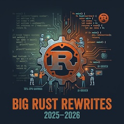

# Big Rust Rewrites, 2025–2026
<!-- tags: rust -->

40 public Rust rewrites from Mar 2025 to Nov 2026, newest first. Eleven of the 24 from 2026 say AI agents wrote much of the code; in 2025 only Agoda (an AI-assisted prototype) and Microsoft's research program mention AI at all.

Scope: rewrites or ports of an existing system, service or component, announced by the company or project itself. Most are big companies or major open-source toolchains; a few smaller projects (Ladybird, Mold, Prime Intellect, Momento, Goldsky, Radar, Spatie, LambdaWorks) are kept because they are widely cited.

Earlier posts on the topic: [The State of "Let's Rewrite It in Rust"](../2025/2025-06-10-rewrite-in-rust.md) (2025) and [Microsoft Gets Rusty](../2025/2025-06-04-ms-rusty.md) (2025).

## Timeline

| # | Date | Rewrite | From | Result |
| --- | --- | --- | --- | --- |
| 1 | 2026-11 | [**Anthropic**: Messages API](#anthropic-messages-api) | 🤖 Python | 70% less CPU, 80% less memory per request |
| 2 | 2026-11 | [**Confluent**: Kafka client](#confluent-kafka-client) | 🤖 Java (JVM) | Restarted after 3 months |
| 3 | 2026-11 | [**Spatie**: Ray 4](#spatie-ray-4) | 🤖 Electron / React | 4x less idle memory, ~194x faster on 10K logs |
| 4 | 2026-11 | [**Discord**: desktop and mobile apps](#discord-desktop-and-mobile-apps) | Electron / React Native | Early build 290 MB RAM vs 1–4 GB |
| 5 | 2026-10 | [**LambdaWorks**: JVM microservices](#lambdaworks-jvm-microservices) | 🤖 JVM | ~70% lower server costs, 85.7% less allocated memory |
| 6 | 2026-10 | [**Shopify**: storefront renderer](#shopify-storefront-renderer) | Ruby | In progress |
| 7 | 2026-10 | [**Cloudflare**: tsrs TypeScript compiler](#cloudflare-tsrs-typescript-compiler) | 🤖 Go | Up to 8x faster, 70% less memory |
| 8 | 2026-10 | [**Prime Intellect**: Prime Agent](#prime-intellect-prime-agent) | 🤖 not stated | Lower cold-start latency and memory |
| 9 | 2026-10 | [**Mold**: linker](#mold-linker) | C++ | Drop-in replacement, bugs fixed |
| 10 | 2026-09 | [**GitHub**: Copilot runtime](#github-copilot-runtime) | 🤖 TypeScript | 800K+ lines in 128 PRs |
| 11 | 2026-09 | [**OpenAI**: Habitat storage](#openai-habitat-storage) | 🤖 Python | 6x CPU, 15x memory efficiency |
| 12 | 2026-09 | [**Google**: Chrome XML parser](#google-chrome-xml-parser) | libxml2 (C) | Removes XML memory corruption classes |
| 13 | 2026-08 | [**pnpm**: v12 package manager](#pnpm-v12-package-manager) | TypeScript (Node.js) | Native binary; 2–3x faster cyclic peer resolution |
| 14 | 2026-08 | [**DataFusion Comet**: Spark execution](#datafusion-comet-spark-execution) | Spark (JVM) | 2x on TPC-DS, about 50% lower cost |
| 15 | 2026-07 | [**Bun**: runtime](#bun-runtime) | 🤖 Zig | 128 old bugs fixed |
| 16 | 2026-07 | [**Meta**: React Compiler](#meta-react-compiler) | 🤖 TypeScript | 3x faster as a Babel plugin |
| 17 | 2026-06 | [**Goldsky**: streaming pipelines](#goldsky-streaming-pipelines) | Apache Flink (JVM) | CPU 10+ cores → 0.3 |
| 18 | 2026-04 | [**Google**: Pixel baseband DNS parser](#google-pixel-baseband-dns-parser) | C | Shipped in Pixel 10 modem; 371 KB footprint |
| 19 | 2026-03 | [**Vite**: Vite 8 / Rolldown](#vite-vite-8--rolldown) | Rollup (JS) + esbuild (Go) | 10–30x faster than Rollup; single bundler |
| 20 | 2026-02 | [**Ladybird**: LibJS frontend](#ladybird-libjs-frontend) | 🤖 C++ | 25K lines in 2 weeks, zero regressions |
| 21 | 2026-02 | [**Meta**: messaging library](#meta-messaging-library) | C | No figures published |
| 22 | 2026-01 | [**Yarn**: Yarn 6](#yarn-yarn-6) | TypeScript (Node.js) | Warm Next.js install 577 ms → 184 ms |
| 23 | 2026-01 | [**WhatsApp**: media library](#whatsapp-media-library) | C++ | 160K → 90K lines |
| 24 | 2026-01 | [**X**: For You algorithm](#x-for-you-algorithm) | Scala (JVM) | Rebuilt in Rust + Python |
| 25 | 2025-12 | [**Microsoft**: research program](#microsoft-research-program) | 🤖 C / C++ | Goal: 1M lines per engineer-month |
| 26 | 2025-10 | [**Vercel**: Next.js 16 / Turbopack](#vercel-nextjs-16--turbopack) | Webpack (JS) | 2–5x faster builds, up to 10x Fast Refresh |
| 27 | 2025-10 | [**Canonical**: Ubuntu sudo and coreutils](#canonical-ubuntu-sudo-and-coreutils) | C | Default in Ubuntu 25.10 |
| 28 | 2025-10 | [**Agoda**: Feature Store](#agoda-feature-store) | 🤖 Scala (JVM) | 84% lower cost at 5x traffic |
| 29 | 2025-09 | [**Cloudflare**: FL2 proxy](#cloudflare-fl2-proxy) | NGINX / LuaJIT | 10 ms faster median, 25% boost |
| 30 | 2025-09 | [**Microsoft**: DirectWriteCore](#microsoft-directwritecore) | C++ | 154K lines in 6 months; 5–15% faster shaping |
| 31 | 2025-09 | [**Proton**: Mail mobile apps](#proton-mail-mobile-apps) | Kotlin (JVM) and Swift | 80% of code shared |
| 32 | 2025 | [**Momento**: data plane](#momento-data-plane) | Kotlin (JVM) | 3-year migration |
| 33 | 2025-08 | [**Google**: Chrome PNG decoder](#google-chrome-png-decoder) | libpng (C) | Shipped in Chrome 139; `libpng` removed from Blink |
| 34 | 2025-08 | [**Radar**: geocoding](#radar-geocoding) | Elasticsearch (JVM) + MongoDB | One Rust service replaced both |
| 35 | 2025-06 | [**OpenAI**: Codex CLI](#openai-codex-cli) | TypeScript | No Node.js needed |
| 36 | 2025-06 | [**Microsoft**: SymCrypt](#microsoft-symcrypt) | C | No figures published |
| 37 | 2025 | [**Grab**: Counter Service](#grab-counter-service) | Go | 70% infrastructure savings |
| 38 | 2025-05 | [**Meta**: Pyrefly](#meta-pyrefly) | OCaml (Pyre) | Checks 1.8M lines/sec; succeeds Pyre |
| 39 | 2025-05 | [**AWS**: Aurora DSQL](#aws-aurora-dsql) | Kotlin (JVM) | 10x throughput vs tuned Kotlin |
| 40 | 2025-03 | [**Google**: Chrome fonts](#google-chrome-fonts) | FreeType (C) | Removes font vulnerability classes |

🤖 = AI-assisted, per the source. Names link to details. ⭐ in a Source line = detailed write-up worth reading in full.

## Takeaways

Across the 40 rewrites, five patterns stand out.

- **Timing:** agent-driven rewrites start in 2026 (11 of the 24 entries). The 2025 rewrites were done by hand, with AI at most for a prototype (Agoda) or as a research goal (Microsoft).
- **Verification:** no team trusted the agents' own tests. Each checked the new code against something independent:
  - Live traffic shadowed against the old system: Anthropic, Agoda.
  - Byte-identical output: Ladybird, Shopify (planned).
  - An existing test suite or behavioral harness the new code must pass: Bun (its TypeScript tests), Ladybird (test262), DataFusion Comet (Spark's 24,000+ tests), tsrs (TypeScript conformance tests), React Compiler (1,725 fixtures), Spatie (parity-fix loop against Ray 3), LambdaWorks (compatibility contracts and versioned review workflows in Pogon).
  - Differential fuzzing against the old code: WhatsApp.
  - End-to-end tests added before porting started: GitHub.
- **Failures happen:** Confluent restarted its agent-driven port after 3 months; Momento's first Rust version did not cut latency by itself.
- **Why Rust:** three main drivers show up repeatedly:
  - Memory and CPU cost (Anthropic, OpenAI, Grab, Agoda, AWS, Goldsky, LambdaWorks).
  - Memory safety on untrusted input in C/C++ parsers and system code (WhatsApp, Chrome fonts/PNG/XML, Pixel baseband DNS, Microsoft DirectWriteCore, Ubuntu sudo).
  - Replacing Node.js/JS developer tooling with native binaries (pnpm, Yarn 6, Vite 8 / Rolldown, Next.js Turbopack, React Compiler, tsrs, Codex CLI, GitHub Copilot runtime) and Electron apps with GPUI (Discord, Spatie Ray 4).
- **Incremental vs. big-bang:** most teams avoided a flag-day cutover and ran old and new side by side:
  - Component by component behind interop shims: GitHub Copilot runtime, LambdaWorks.
  - Opt-in first, default later: pnpm, Next.js Turbopack, Vite (Rolldown), Chrome PNG, Codex CLI.
  - Built in parallel, then swapped: WhatsApp, Agoda, Anthropic.
  - Big-bang ports were the exception, and only with a strong test suite as a safety net: Bun, Mold.

## Rewrites

One snapshot per rewrite, in table order. Figures are as reported by each company.

### Anthropic: Messages API

- **When:** Nov 25, 2026
- **Status:** Shipped, serving production traffic
- **What:** The Claude Messages API service, rewritten from Python.
- **Why:** Efficiency of the service that carries all Claude API traffic.
- **How:** The existing Python service was the reference: production traffic was shadowed to the Rust version, and agent teams tracked down and fixed every difference.
- **Result:** About 70% less CPU per request in one region, over 80% less memory per request, about 20% faster median time to first token.
- **By the numbers:** First version in about 1 week; about 5 months of verification.
- **AI:** Claude wrote the first version of the core path; agent teams handled the divergence fixes.
- **Source:** [Anthropic](https://www.anthropic.com/research/migrating-api-to-rust) — ⭐ *Must-read: content-blind shadow diffing grouped by fingerprint, replaying one model output to both stacks, why ~98% passing tests still meant ~25% production parity.*

### Confluent: Kafka client

- **When:** Nov 24, 2026
- **Status:** Released as Confluent's Rust client (confluent-kafka crate)
- **What:** A native Rust Kafka client translated from the Java client.
- **Why:** Keep Confluent's non-Java clients in step with the Java client.
- **How:** A multi-agent translation workflow; engineers approve plans and make architecture calls, such as mapping Java threads to Tokio tasks.
- **Result:** The first attempt was restarted; the goal is a continuous Java → Rust translation pipeline.
- **By the numbers:** First attempt ran 3 months before the restart.
- **AI:** Multi-agent workflow throughout.
- **Source:** [The New Stack](https://thenewstack.io/confluent-kafka-rust-agents/) and [Confluent docs](https://docs.confluent.io/kafka-clients/rust/current/overview.html)

### Spatie: Ray 4

- **When:** Nov 24, 2026
- **Status:** Shipped
- **What:** Ray, Spatie's desktop debugging app, rewritten from Electron and React to Rust using Zed's GPUI framework.
- **Why:** Chromium's baseline memory footprint limited how fast and light Ray could get, especially when receiving heavy log dumps.
- **How:** Claude mapped all features from the Ray 3 codebase (manually validated by the team), built a GPUI component kit, and ran automated parity-fix loops against failing checks before 3 weeks of manual UI polish and code review.
- **Result:** Ready to receive logs in 41 ms, ~194x faster handling 10,000 logs than Ray 3, ~4x less idle memory (~350 MB even after 10,000 logs), and a ~5x smaller download.
- **By the numbers:** Five 7–8 hour agent loops in 1 week for the initial port; 4 weeks total vs an estimated 10 months by hand.
- **AI:** Claude built the initial port and ran parity-fix loops, followed by manual polish and review agents.
- **Source:** [Spatie blog](https://spatie.be/blog/ray-is-getting-rusty)

### Discord: desktop and mobile apps

- **When:** Nov 4, 2026 (announced)
- **Status:** In progress; user testing pending
- **What:** Desktop leaves Electron; mobile drops React Native. Both share app code in Rust.
- **Why:** Electron's memory use, and one shared codebase for desktop and mobile. Discord has used Rust since 2018 in infrastructure, voice and parts of the client.
- **How:** Desktop UI on GPUI, the GPU-accelerated framework from the makers of Zed (not Tauri); mobile keeps native UI on top of the shared Rust core.
- **Result:** An early build used about 290 MB of RAM with two accounts signed in; today's app often uses 1–4 GB.
- **AI:** Not stated.
- **Source:** CTO Stanislav Vishnevskiy's post on X, reported by [InfoQ](https://www.infoq.com/news/2026/11/discord-rust-rewrite-gpui-zed/)

### LambdaWorks: JVM microservices

- **When:** Oct 29, 2026
- **Status:** Shipped
- **What:** Multiple separate JVM microservices consolidated into a single Rust modular monolith (one Rust package/process with shared PostgreSQL, Redis, Kafka, and HTTP mechanics).
- **Why:** Higher throughput, leaner infrastructure, lower operating costs, fewer deployments, simpler CI, and easier maintenance.
- **How:** Migrated service by service using Pogon, LambdaWorks' internal AI software factory, with versioned migration skills, compatibility contracts, and automated review/check loops running between engineering sessions; engineers set scope and approved handoffs, updating the skills after each service.
- **Result:** Server costs fell by about 70%; allocated production memory fell by 85.7%; fewer deployments and simpler CI.
- **AI:** Coding agents orchestrated by Pogon handled implementation, automated checks, and review fixes within engineer-approved boundaries.
- **Source:** [LambdaWorks blog](https://www.lambdaworks.io/blog/jvm-to-rust-migration-with-software-factory)

### Shopify: storefront renderer

- **When:** Oct 2026 (announced)
- **Status:** In progress
- **What:** The storefront renderer, Ruby → Rust.
- **Why:** Not stated.
- **How:** The new renderer's output is compared byte for byte with the Ruby one before switching over.
- **Result:** None published yet.
- **AI:** Implied: Lütke says Shopify engineers now work as "verification engineers", building harnesses and acceptance tests.
- **Source:** [Vercel Ship 2026 recap](https://vercel.com/blog/vercel-ship-2026-recap). Tobi Lütke's own words in the fireside "The Third Customer" (video published Oct 22, 2026); no Shopify blog post or GitHub repo found.

### Cloudflare: tsrs TypeScript compiler

- **When:** Oct 20, 2026
- **Status:** Experimental release on npm (tsrs)
- **What:** A Rust port of the TypeScript compiler, started by Max Schwenk at Owner.com and now developed by Cloudflare and VoidZero inside Oxc. Theo Browne's tsc-rs port is being merged into it.
- **Why:** Faster, lighter type checking, so AI agents and CI can check code cheaply; Rust also compiles to WebAssembly for browser and edge tools.
- **How:** Agents ported the compiler; correctness is checked with TypeScript's conformance tests, deliberately broken real projects, and Miri for memory bugs. Built in close collaboration with the TypeScript team, not as a fork.
- **Result:** Up to 8x faster and 70% less memory than TypeScript 7.0, in Cloudflare's benchmark.
- **AI:** Written by agents with Claude Opus 5.5.
- **Source:** [Cloudflare blog](https://blog.cloudflare.com/typescript-rust-port/) and [tsc-rs repo](https://github.com/pingdotgg/ts-rust) — ⭐ *Must-read: read the tsc-rs repo: byte-for-byte conformance corpus, benchmark method, a documented known-differences list and a candid restart story.*

### Prime Intellect: Prime Agent

- **When:** Oct 9, 2026
- **Status:** Announced
- **What:** The Prime Agent coding agent, rebuilt in Rust.
- **Why:** Lower cold-start latency and memory use.
- **How:** A large swarm of coding agents did the rebuild.
- **Result:** Lower cold-start latency and memory use.
- **By the numbers:** 2,000+ agents, 200B+ tokens, about 2 weeks.
- **AI:** Agent swarm throughout.
- **Source:** [Prime Intellect blog](https://www.primeintellect.ai/blog/prime-agent-rust) — ⭐ *Must-read: planner / implementer / adversarial reviewer / verifier pipeline, TUI frame diffing, a noise-checked performance hillclimb (vendor-run benchmarks).*

### Mold: linker

- **When:** Oct 5, 2026 (v3.0.0)
- **Status:** Shipped
- **What:** The whole linker, C++ → Rust; 2.42.1 is the last C++ release.
- **Why:** Rust had matured for systems software, and the project wants Linux distros to adopt mold as their default linker, including linker-script support.
- **How:** A complete rewrite released as a drop-in replacement; Cargo replaces CMake and the oneTBB dependency is gone.
- **Result:** Same options, targets and output apart from bug fixes; out-of-bounds reads now stop with a panic instead of corrupting memory.
- **AI:** Not stated.
- **Source:** [mold 3.0.0 release notes](https://github.com/rui314/mold/releases/tag/v3.0.0)

### GitHub: Copilot runtime

- **When:** Sep 16, 2026
- **Status:** Shipped
- **What:** The Copilot agent runtime behind the Copilot CLI, app and SDK, from TypeScript on Node.js to Rust with a C ABI.
- **Why:** Every SDK consumer in every language had to ship Node.js or a bundled V8, on the order of 100 MB per client. Products needed in-process embedding, fast startup and low memory.
- **How:** Incremental: components moved to Rust behind thin interop shims and shipped through 128 PRs to main, with no long-lived branch. Missing end-to-end tests were added before porting.
- **Result:** The runtime now ships as a native binary; performance improved by orders of magnitude, per GitHub.
- **By the numbers:** About 130K lines of TypeScript estimated at the start; 800K+ lines of Rust; about 14.5 weeks; mostly one developer; about $120K of tokens.
- **AI:** Copilot agents wrote most of the code.
- **Source:** [GitHub blog](https://github.blog/ai-and-ml/generative-ai/migrating-the-github-copilot-runtime-to-rust-using-copilot/) — ⭐ *Must-read: why in-place component-by-component on main beat big-bang and A/B, interop shim lifecycle, catalogue of real regressions.*

### OpenAI: Habitat storage

- **When:** Sep 11, 2026
- **Status:** Shipped; 95% of traffic on Rust
- **What:** Habitat, the storage platform behind ChatGPT, from Python to Rust.
- **Why:** Efficiency at ChatGPT scale.
- **How:** A small team rebuilt the service with coding agents.
- **Result:** 6x CPU and 15x memory efficiency.
- **By the numbers:** 2 engineers, one quarter (Q2 2026).
- **AI:** Codex with GPT-5.5.
- **Source:** [OpenAI](https://openai.com/index/scaling-storage-one-billion-users-part-one/) — ⭐ *Must-read, though not for the rewrite itself (one short section): measuring asyncio event-loop delay, a metastable failure from aiohttp's LIFO connection reuse, a config poll that stalled workers.*

### Google: Chrome XML parser

- **When:** Sep 8, 2026 (Chrome 153)
- **Status:** Shipped across Android, ChromeOS, Linux, macOS and Windows
- **What:** Non-XSLT XML parsing in Chrome moved from libxml2 (C) to Rust.
- **Why:** Eliminate memory corruption vulnerabilities in XML parsing while maintaining web-standards compatibility.
- **How:** Replaced the C parser for non-XSLT paths (`DOMParser`, `XMLHttpRequest.responseXML`, and standalone/external SVG images) alongside Chrome's XSLT deprecation.
- **Result:** Removes memory corruption bug classes in standard XML and SVG parsing.
- **AI:** Not stated.
- **Source:** [Chrome 153 release notes](https://developer.chrome.com/release-notes/153)

### pnpm: v12 package manager

- **When:** Aug 26, 2026 (v12.0.0)
- **Status:** Shipped
- **What:** The pnpm package manager, rewritten from TypeScript on Node.js to Rust (codenamed `pacquet`).
- **Why:** Eliminate Node.js runtime startup overhead and speed up filesystem-heavy installs and dependency resolution.
- **How:** Developed as `pacquet`, merged into the main pnpm monorepo in May 2026, and rolled out incrementally as an opt-in backend across v11.2–v11.10 before becoming stable in v12.0.0.
- **Result:** Ships as native per-platform binaries with deterministic lockfiles; large workspaces with cyclic dependencies resolve peers 2–3x faster with about 25% less memory.
- **AI:** Not stated in the release post.
- **Source:** [pnpm 12.0 release blog](https://pnpm.io/blog/releases/12.0)

### DataFusion Comet: Spark execution

- **When:** Aug 7, 2026 (v1.0.0)
- **Status:** Shipped (1.2.0 by Nov 2026)
- **What:** A Spark plugin that moves query execution from the JVM to Rust (Apache DataFusion); Spark stays the coordinator. Started at Apple, donated to Apache in March 2024.
- **Why:** JVM limits in Spark: garbage-collection overhead and row-by-row execution.
- **How:** Translates Spark physical plans into DataFusion plans with no code changes, and falls back to Spark for anything not supported. Runs Spark's own test suite in CI.
- **Result:** 2x speedup on 1 TB TPC-DS, about 50% lower infrastructure cost ([Google Cloud community benchmark](https://medium.com/google-cloud/moving-apache-spark-beyond-the-jvm-with-native-acceleration-0835ffcdc461)). Apple runs it on its petabyte-scale Iceberg lakehouse.
- **By the numbers:** 1.0 had 244 commits from 23 contributors; 24,000+ Spark unit tests in CI.
- **AI:** Not stated.
- **Source:** [Apache DataFusion blog](https://datafusion.apache.org/blog/2026/08/07/datafusion-comet-1.0.0)

### Bun: runtime

- **When:** Jul 8, 2026 (merged May 14, shipped in v1.4.0)
- **Status:** Shipped
- **What:** The whole runtime, Zig → Rust. Bun is owned by Anthropic and runs Claude Code.
- **Why:** Most of Bun's crash bugs were use-after-free, double-free and missed frees; in safe Rust these are compile errors, and Drop handles cleanup.
- **How:** A mechanical port with as few behavior changes as possible, driven by a PORTING.md rulebook. Bun's test suite is written in TypeScript, so it served as an independent conformance check.
- **Result:** 128 long-standing bugs fixed; live in Claude Code since v2.1.181, with 10% faster startup on Linux.
- **By the numbers:** About 535K lines of Zig; 11 days; up to 64 agent instances in parallel.
- **AI:** An agent harness with a pre-release Claude model.
- **Source:** [Bun blog](https://bun.com/blog/bun-in-rust) — ⭐ *Must-read: the case for an all-at-once mechanical port, adversarial diff-only review, agents clobbering each other's git state.*

### Meta: React Compiler

- **When:** Jul 2026
- **Status:** Experimental, merged into the React repo
- **What:** React Compiler, TypeScript → Rust.
- **Why:** Faster builds and direct use inside Rust-based JavaScript tools such as Turbopack, Oxc and SWC, without a Babel step.
- **How:** A port that keeps a Babel-like public API, so upgrading needs no config changes.
- **Result:** About 3x faster as a Babel plugin, up to 10x for the transform; all 1,725 test fixtures pass.
- **AI:** "Majority coded by AI", architecture set by humans.
- **Source:** [React pull request #36173](https://github.com/react/react/pull/36173) — ⭐ *Must-read: porting a compiler pass by pass, with intermediate state compared after every pass; arenas and indices for the borrow checker.*

### Goldsky: streaming pipelines

- **When:** Jun 2026
- **Status:** Shipped and open-sourced (Streamling)
- **What:** Streaming pipelines moved from Apache Flink to Streamling, Goldsky's own Rust runtime.
- **Why:** Flink was hard for anyone outside the streaming core team to extend, and the AWS bill was high.
- **How:** A new runtime built on Rust, Apache Arrow and DataFusion.
- **Result:** Average CPU from 10+ cores to 0.3 in a Kafka-to-ClickHouse workload.
- **By the numbers:** Over $1M a year saved.
- **AI:** Not stated.
- **Source:** [Goldsky blog](https://goldsky.com/blog/open-sourcing-streamling)

### Google: Pixel baseband DNS parser

- **When:** Apr 10, 2026
- **Status:** Shipped in Pixel 10 modem firmware
- **What:** The DNS packet parser inside Google Pixel's cellular baseband firmware, C → Rust (`hickory-proto`).
- **Why:** Cellular modems run tens of megabytes of predominantly memory-unsafe firmware on untrusted network packets, making C DNS parsers a high-value remote attack surface.
- **How:** Adopted the open-source `hickory-proto` crate and contributed upstream `no_std` support across `hickory-dns`, `rust-url` and `ipnet` so it could run in a bare-metal firmware environment behind a thin Rust shim.
- **Result:** Eliminates memory-safety vulnerability classes in cellular DNS parsing; adds 371 KB total code size (4 KB shim, 17 KB core/alloc/builtins, 350 KB library).
- **AI:** Not stated.
- **Source:** [Google Security Blog](https://blog.google/security/bringing-rust-to-the-pixel-baseband/) — ⭐ *Must-read: Rust in bare-metal firmware: rlibs wrapped in one staticlib, a `compiler_builtins` memcpy regression, allocator and panic glue.*

### Vite: Vite 8 / Rolldown

- **When:** Mar 12, 2026 (v8.0)
- **Status:** Shipped
- **What:** Vite replaced its dual-bundler core—esbuild (Go) for dev and Rollup (JS) for production—with Rolldown, a single Rust bundler built on Oxc.
- **Why:** Maintaining two separate transformation pipelines and plugin systems created glue code and edge-case drift, while Rollup's JavaScript performance bottlenecked large builds.
- **How:** Built Rolldown with Rollup/Vite plugin API compatibility and an automatic config compatibility layer, previewed as `rolldown-vite` on Vite 7 before becoming the default in Vite 8.
- **Result:** 10–30x faster than Rollup in benchmarks (matching esbuild's speed); adds ~15 MB to install size (~10 MB from `lightningcss`, ~5 MB from Rolldown).
- **AI:** Not stated.
- **Source:** [Vite 8.0 announcement](https://vite.dev/blog/announcing-vite8)

### Ladybird: LibJS frontend

- **When:** Feb 23, 2026
- **Status:** Shipped in Ladybird
- **What:** The JavaScript engine's lexer, parser and bytecode generator, C++ → Rust.
- **Why:** Ladybird adopted Rust for memory safety in new and ported code.
- **How:** A human-directed port with coding agents; the new code had to produce identical output to the C++ version.
- **Result:** Zero regressions on 52,898 test262 tests and 12,461 of Ladybird's own.
- **By the numbers:** About 25K lines in about 2 weeks.
- **AI:** Claude Code and Codex.
- **Source:** [Ladybird blog](https://ladybird.org/posts/adopting-rust)

### Meta: messaging library

- **When:** Feb 10, 2026
- **Status:** Not stated
- **What:** A core cross-platform messaging library, C → Rust.
- **Why:** Not stated in writing; discussed on the podcast.
- **How:** Not stated in writing.
- **Result:** No figures published.
- **AI:** Not stated.
- **Source:** [Meta Tech Podcast](https://www.metacareers.com/podcast/from-c-to-rust-on-mobile/)

### Yarn: Yarn 6

- **When:** Jan 28, 2026 (preview; `6.0.0-rc.23` by Oct 2026)
- **Status:** Release candidate (`yarnpkg/zpm`)
- **What:** The Yarn package manager, rewritten from TypeScript on Node.js to Rust.
- **Why:** Higher responsiveness, lower memory use, and standalone binary distribution (`Yarn Switch`) without Node.js startup overhead.
- **How:** Rewritten over more than a year in the `yarnpkg/zpm` repository, with Yarn 5.x serving as the JavaScript transition bridge and long-term maintenance line.
- **Result:** Warm-cache Next.js install dropped from 577 ms (legacy Yarn) to 184 ms in Yarn's preview benchmark.
- **AI:** Not stated.
- **Source:** [Yarn 6 Preview blog](https://yarn6.netlify.app/blog/2026-01-28-yarn-6-preview/) and [Maël Nison's announcement](https://bsky.app/profile/mael.dev/post/3mdikjnqy3c2r)

### WhatsApp: media library

- **When:** Jan 27, 2026
- **Status:** Shipped on Android, iOS, web, wearables and more
- **What:** wamedia, the library that checks shared media files, C++ → Rust.
- **Why:** Media checks run automatically on untrusted input. The 2015 Stagefright bug in Android's media libraries showed how dangerous that is.
- **How:** Not an incremental rewrite: the Rust version was built in parallel with the C++ one and checked against it with differential fuzzing plus integration and unit tests.
- **Result:** 160K lines of C++ became 90K lines of Rust.
- **AI:** Not stated.
- **Source:** [Engineering at Meta](https://engineering.fb.com/2026/01/27/security/rust-at-scale-security-whatsapp/)

### X: For You algorithm

- **When:** Jan 20, 2026
- **Status:** In production for the For You feed; migration partial
- **What:** The "For You" feed algorithm, rebuilt in Rust and Python to replace the 2023 Scala version.
- **Why:** Not stated.
- **How:** A ground-up rebuild around a Grok-based ranking model, published as open source.
- **Result:** The open-source repo was still about 24% Scala in Aug 2026.
- **AI:** Not stated.
- **Source:** [xai-org/x-algorithm on GitHub](https://github.com/xai-org/x-algorithm)

### Microsoft: research program

- **When:** Dec 2025
- **Status:** Goal / research
- **What:** A research program to move Microsoft's C and C++ code to Rust by 2030.
- **Why:** Remove the memory-safety bugs that C and C++ allow.
- **How:** AI agents guided by algorithms, aiming at "1 engineer, 1 month, 1 million lines" (Galen Hunt).
- **Result:** None yet; Microsoft says Windows is not being rewritten.
- **AI:** Planned as the core of the approach.
- **Source:** [The Register](https://www.theregister.com/2025/12/24/microsoft_rust_codebase_migration), reporting Hunt's LinkedIn post

### Vercel: Next.js 16 / Turbopack

- **When:** Oct 21, 2025 (Next.js 16)
- **Status:** Shipped as default bundler
- **What:** Turbopack, Vercel's Rust-based incremental bundler, became the default bundler for Next.js, replacing Webpack (JavaScript).
- **Why:** Faster development refresh and production builds on large React applications through fine-grained incremental computation.
- **How:** Rolled out opt-in across Next.js 15 (reaching >50% of dev sessions and 20% of production builds on 15.3+) before becoming default in Next.js 16, with `--webpack` kept as an escape hatch.
- **Result:** 2–5x faster production builds and up to 10x faster Fast Refresh.
- **AI:** No.
- **Source:** [Next.js 16 blog](https://nextjs.org/blog/next-16) and [Next.js 15.5 blog](https://nextjs.org/blog/next-15-5)

### Canonical: Ubuntu sudo and coreutils

- **When:** Oct 2025 (Ubuntu 25.10)
- **Status:** Shipped
- **What:** sudo and coreutils replaced by Rust versions.
- **Why:** Memory safety in core system tools.
- **How:** Adopted existing Rust projects, sudo-rs and uutils coreutils, rather than writing new ones.
- **Result:** First major distro to make sudo-rs the default.
- **AI:** Not stated.
- **Source:** [Ubuntu Discourse](https://discourse.ubuntu.com/t/adopting-sudo-rs-by-default-in-ubuntu-25-10/60583)

### Agoda: Feature Store

- **When:** Oct 8, 2025
- **Status:** Shipped
- **What:** Feature Store serving, Scala → Rust.
- **Why:** Latency problems and scaling bottlenecks on the JVM.
- **How:** A 1-week proof of concept first; shadow testing against the Scala service before production.
- **Result:** 84% lower cost while handling 5x more traffic.
- **By the numbers:** CPU at 40% and memory at 15% of Scala levels.
- **AI:** The proof of concept was built with AI tools by a team with no Rust experience.
- **Source:** [Agoda Engineering](https://medium.com/agoda-engineering/why-we-bet-on-rust-to-supercharge-feature-store-at-agoda-ed4a70d2efb7)

### Cloudflare: FL2 proxy

- **When:** Sep 26, 2025
- **Status:** Shipped
- **What:** FL, the core proxy layer, from NGINX and LuaJIT to Rust (FL2).
- **Why:** Speed and security of the layer every request passes through.
- **How:** A new proxy, FL2, replaced the NGINX/LuaJIT-based FL.
- **Result:** 10 ms faster at the median; 25% performance boost.
- **AI:** No.
- **Source:** [Cloudflare blog](https://blog.cloudflare.com/20-percent-internet-upgrade/) — ⭐ *Must-read: Rust modules inside the old NGINX first, the Flamingo FL1-vs-FL2 test system, raw-byte fallback to the old proxy.*

### Microsoft: DirectWriteCore

- **When:** Sep 2025 (reported at RustConf 2025)
- **Status:** Shipped in Windows
- **What:** DirectWriteCore, Windows' text-rendering and font-shaping subsystem, C++ → Rust.
- **Why:** Memory safety in font parsing and rendering.
- **How:** Targeted subsystem rewrite inside Windows rather than a full OS rewrite.
- **Result:** 5–15% faster font shaping.
- **By the numbers:** 154,000 lines of Rust; 2 engineers; 6 months.
- **AI:** No.
- **Source:** [Mark Russinovich's RustConf 2025 keynote](https://www.youtube.com/watch?v=uDtMuS7BExE)

### Proton: Mail mobile apps

- **When:** Sep 2025 (launch; write-up in 2026)
- **Status:** Shipped
- **What:** A complete rewrite of the Proton Mail iOS and Android apps; business logic moved from Kotlin and Swift into one Rust core.
- **Why:** Duplicated work and feature gaps between the iOS and Android teams. React Native, Flutter and Kotlin Multiplatform were tested first and rejected.
- **How:** Native UI on each platform (Jetpack Compose, SwiftUI) on top of a shared Rust core that holds all business logic, down to navigation.
- **Result:** Almost 80% of code shared across platforms; 12 feature releases in the 2 months after launch.
- **AI:** Not stated.
- **Source:** [Proton blog](https://proton.me/blog/next-generation-proton-mail-mobile-apps)

### Momento: data plane

- **When:** 2025 (conference talks)
- **Status:** Shipped; all services moved from Kotlin to Rust
- **What:** The serverless cache's data plane, Kotlin → Rust.
- **Why:** Unpredictable tail latencies on the JVM.
- **How:** Storage layer first, then the routing layer, then remaining services, ending with a complex workflow server.
- **Result:** The first Rust version did not cut latency by itself; the team later reported Rust did not slow them down as they had feared.
- **By the numbers:** About 3 years from first to last service.
- **AI:** Not stated.
- **Source:** [Talk by Momento's Ramya Krishnamoorthy on InfoQ](https://www.infoq.com/presentations/rust-lessons/) and [follow-up talk by Ruth Linehan](https://infoq.com/presentations/rust-tps-service) — ⭐ *Must-read: the first talk: p999 benchmark method, debugging an `h2` mutex bottleneck from 32K to 75K TPS, a minor `tonic` upgrade that took prod down.*

### Google: Chrome PNG decoder

- **When:** Aug 2025 (Chrome 139; legacy flag removed in M142, Oct 2025)
- **Status:** Shipped
- **What:** Chrome's Blink and Skia PNG decoding moved from `libpng` (C) to the Rust `png` crate (`SkPngRustDecoder`).
- **Why:** Eliminate memory-safety vulnerabilities when decoding untrusted PNG images from the web.
- **How:** Shipped behind `chrome://flags/#rusty-png` while closing edge-case parity bugs, then made default in M139 and followed by systematically removing `libpng` dependencies from Blink and Skia.
- **Result:** Memory-safe PNG decoding in production across Chromium; `libpng` references stripped from Blink and Skia.
- **AI:** No.
- **Source:** [Chromium issue #443128323](https://issues.chromium.org/issues/443128323) and [Chromium Security Quarterly Updates](https://www.chromium.org/Home/chromium-security/quarterly-updates/)

### Radar: geocoding

- **When:** Aug 7, 2025
- **Status:** Shipped
- **What:** Geocoding moved off Elasticsearch, MongoDB and several microservices onto HorizonDB, one Rust service.
- **Why:** Scaling Elasticsearch meant hard JVM tuning; the team wanted linear scaling on commodity hardware and easy local development.
- **How:** Built on RocksDB, S2, Tantivy and FSTs; data preprocessed in Spark and stored as versioned assets in S3.
- **Result:** A single multi-threaded process with predictable latency.
- **AI:** Not stated.
- **Source:** [Radar blog](https://radar.com/blog/high-performance-geocoding-in-rust)

### OpenAI: Codex CLI

- **When:** Jun 2025
- **Status:** Shipped; Rust is the default and only maintained version
- **What:** Codex CLI, TypeScript on Node.js → Rust.
- **Why:** Zero-dependency install (Node v22+ was required), native security bindings for sandboxing, and an extensible protocol.
- **How:** The Rust version shipped side by side as a separate npm tag until it matched the TypeScript one, then became the default.
- **Result:** No Node.js install needed; native OS sandboxing.
- **AI:** Not stated.
- **Source:** [Codex GitHub discussion #1174](https://github.com/openai/codex/discussions/1174)

### Microsoft: SymCrypt

- **When:** Jun 2025
- **Status:** In progress (research)
- **What:** SymCrypt, Microsoft's cryptographic library, being rewritten in Rust.
- **Why:** Modernize a core crypto library with memory safety.
- **How:** Not stated here.
- **Result:** No figures published.
- **AI:** Not stated.
- **Source:** [Microsoft Research blog](https://www.microsoft.com/en-us/research/blog/rewriting-symcrypt-in-rust-to-modernize-microsofts-cryptographic-library/)

### Grab: Counter Service

- **When:** 2025
- **Status:** Shipped
- **What:** Counter Service, Go → Rust.
- **Why:** Infrastructure cost.
- **How:** A rewrite of one high-traffic Go service.
- **Result:** Similar performance at much lower cost.
- **By the numbers:** 20 cores down to 4.5; 70% infrastructure savings.
- **AI:** No.
- **Source:** [Grab Engineering](https://engineering.grab.com/counter-service-how-we-rewrote-it-in-rust) — ⭐ *Must-read: black-box rewrite against the gRPC contract (no line-by-line, no C2Rust), library choices, a sync Redis call inside async code.*

### Meta: Pyrefly

- **When:** May 15, 2025 (alpha open-sourced)
- **Status:** Shipped (open-source, MIT license)
- **What:** A Python type checker and IDE extension written in Rust to succeed Meta's OCaml-based Pyre.
- **Why:** High-speed incremental checking across large monorepos and a unified cross-platform developer experience.
- **How:** Built from the ground up in Rust with incremental updates and open-sourced under the MIT license.
- **Result:** Checks up to 1.8 million lines of code per second on large codebases.
- **AI:** Not stated.
- **Source:** [Engineering at Meta](https://engineering.fb.com/2025/05/15/developer-tools/introducing-pyrefly-a-new-type-checker-and-ide-experience-for-python/)

### AWS: Aurora DSQL

- **When:** May 2025
- **Status:** Shipped
- **What:** The Aurora DSQL database, Kotlin → Rust.
- **Why:** The tuned Kotlin version hit JVM warm-up and garbage-collection limits.
- **How:** A rewrite of the data plane after the Kotlin version was tuned as far as it would go.
- **Result:** 30,000 TPS vs 2,000–3,000 for tuned Kotlin; Rust later became AWS's default for data plane projects.
- **By the numbers:** About 10x throughput.
- **AI:** No.
- **Source:** [All Things Distributed](https://www.allthingsdistributed.com/2025/05/just-make-it-scale-an-aurora-dsql-story.html) — ⭐ *Must-read: what was rewritten first and why, reversing the Kotlin control-plane decision, Rust types encoding Postgres C invariants.*

### Google: Chrome fonts

- **When:** Mar 19, 2025
- **Status:** Shipped
- **What:** Chrome's font processing moved from FreeType (C) to Skrifa (Rust).
- **Why:** Font-parsing security bugs had repeatedly reached users.
- **How:** Replaced FreeType with Skrifa, a Rust library, inside Chrome.
- **Result:** Removes whole classes of font vulnerabilities.
- **AI:** No.
- **Source:** [Chrome for Developers blog](https://developer.chrome.com/blog/memory-safety-fonts) — ⭐ *Must-read: staged FreeType → Skrifa rollout, keeping `unsafe` to `bytemuck`, differential outline and pixel testing plus fuzzing.*

